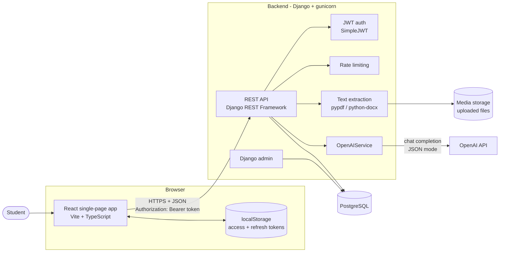
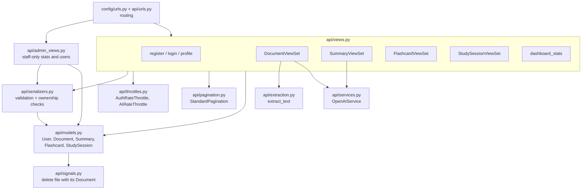
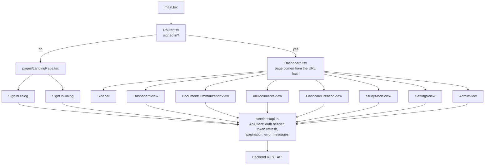
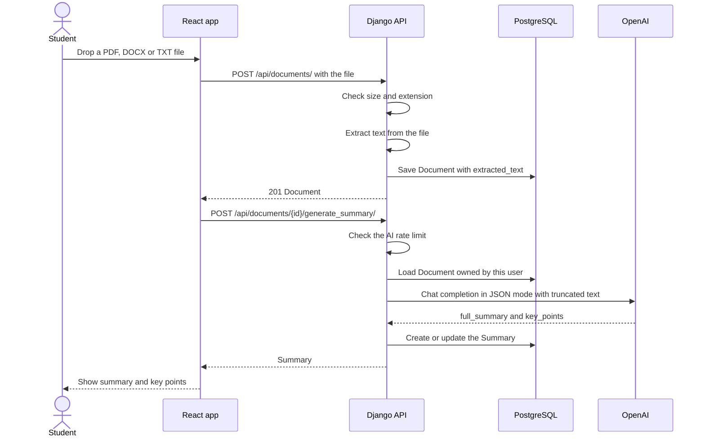
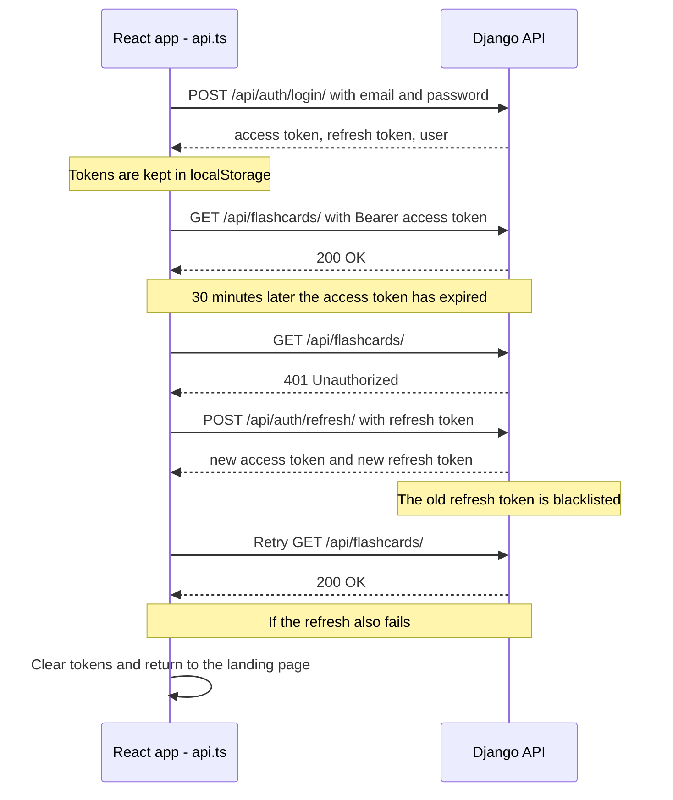
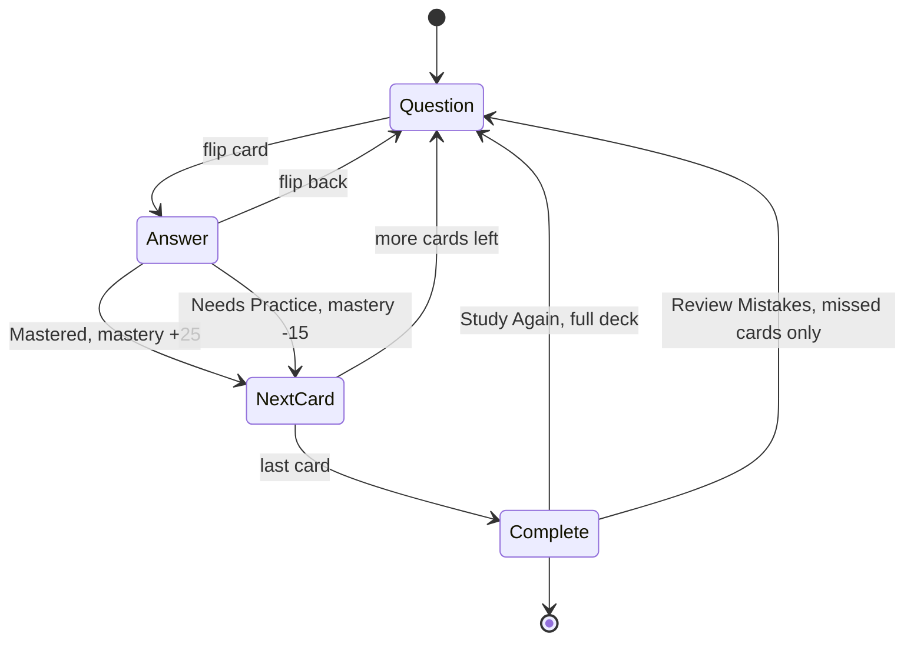
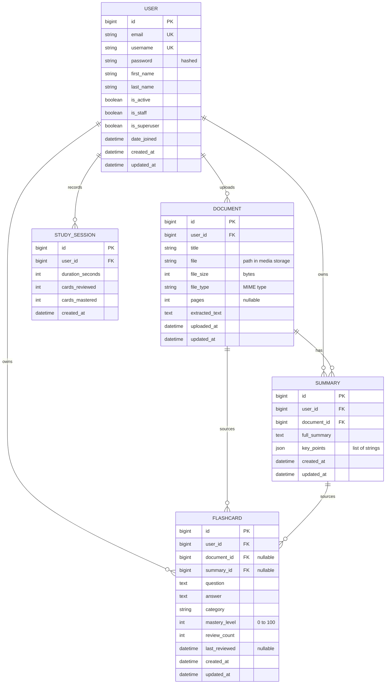

# AI Learning Assistant (Study AI)

Upload your study material, get an AI-written summary, turn it into flashcards, and study them with progress tracking.

- **Backend:** Django 5.2 + Django REST Framework, PostgreSQL, JWT authentication, OpenAI
- **Frontend:** React 18 + TypeScript, built with Vite

## Contents

- [Features](#features)
- [High-level design](#high-level-design)
- [Low-level design](#low-level-design)
- [Database design](#database-design)
- [API reference](#api-reference)
- [Project structure](#project-structure)
- [Running the project](#running-the-project)
- [Environment variables](#environment-variables)
- [Tests and CI](#tests-and-ci)
- [Deployment](#deployment)
- [Security](#security)
- [Troubleshooting](#troubleshooting)

## Features

- **Document upload:** PDF, DOCX and TXT files up to 10MB. Text is extracted once at upload and stored in the database.
- **AI summaries:** a multi-paragraph summary plus key points for each document. Regenerating updates the existing summary.
- **Flashcards:** generate them from a document or a summary, or write your own. Filter by category.
- **Study mode:** flip cards, mark them "Mastered" or "Needs Practice", replay only the cards you missed. Mastery moves in steps (+25 / -15) rather than jumping to 100%.
- **Dashboard:** document, flashcard, study-time and mastery statistics.
- **Accounts:** email + password sign-up, JWT login with automatic token refresh, profile editing.
- **Admin:** staff-only statistics and user list, plus the Django admin site at `/admin/`.

## High-level design

The diagrams in this README are written in [Mermaid](https://mermaid.js.org/), which GitHub renders as images.



**How the pieces fit together**

| Part | Responsibility |
| --- | --- |
| React app | All screens. Talks to the backend only through `front_end/src/services/api.ts`. |
| REST API | Validates input, enforces that users only see their own data, and stores everything. |
| JWT auth | Short-lived access token (30 min) and a rotating refresh token (7 days). |
| Rate limiting | Caps login attempts per IP and AI requests per user to control abuse and OpenAI cost. |
| Text extraction | Reads the uploaded file once and saves the text in the `Document` row. |
| OpenAIService | Sends (truncated) text to OpenAI and validates the JSON it returns. |
| PostgreSQL | Users, documents (including extracted text), summaries, flashcards, study sessions. |

## Low-level design

### Backend modules



### Frontend modules



Pages inside the dashboard are addressed by URL hash, so refresh and the back button work:
`#/dashboard`, `#/summarize`, `#/all-documents`, `#/flashcards`, `#/study`, `#/settings`, `#/admin`.

### Flow: upload a document and summarize it



If the OpenAI call fails, the document stays uploaded and the user can press **Generate Summary** to retry.

### Flow: login and automatic token refresh



### Flow: study session



Each answer calls `POST /api/flashcards/{id}/review/`. When a session completes, the app calls `POST /api/study-sessions/` with the elapsed time, which feeds the dashboard's **Study Time**.

## Database design



Notes:

- Every foreign key uses `ON DELETE CASCADE`. Deleting a document removes its summaries and flashcards, and its file on disk.
- The login identifier is `email`. `username` is generated from the email on sign-up.
- Django also creates its own tables (sessions, permissions, admin log) and SimpleJWT's token blacklist tables. They are omitted above.
- Models live in `backend/api/models.py`; schema changes are in `backend/api/migrations/`.

## API reference

All endpoints are under `/api/` and, except register / login / refresh, require `Authorization: Bearer <access token>`. List endpoints are paginated (`?page=1&page_size=20`, maximum 100).

| Method | Endpoint | Purpose |
| --- | --- | --- |
| POST | `/auth/register/` | Create an account |
| POST | `/auth/login/` | Get access and refresh tokens plus the user |
| POST | `/auth/refresh/` | Exchange a refresh token for a new pair |
| GET, PATCH | `/auth/profile/` | Read or edit your profile |
| GET, POST | `/documents/` | List documents, upload a file (`multipart/form-data` with `title` and `file`) |
| GET, PATCH, DELETE | `/documents/{id}/` | Read, rename or delete a document |
| POST | `/documents/{id}/generate_summary/` | Create or regenerate the summary |
| POST | `/documents/{id}/generate_flashcards/` | Generate cards, body `{"num_cards": 10}` (1 to 50) |
| DELETE | `/documents/delete_all/` | Delete all of your documents |
| GET | `/summaries/` | List summaries, optional `?document={id}` |
| GET, DELETE | `/summaries/{id}/` | Read or delete a summary |
| POST | `/summaries/{id}/generate_flashcards/` | Generate cards from a summary |
| GET, POST | `/flashcards/` | List (`?category=`, `?document=`) or create a card |
| GET, PATCH, DELETE | `/flashcards/{id}/` | Read, edit or delete a card |
| POST | `/flashcards/{id}/review/` | Record a review, body `{"result": "mastered"}` or `"needs_practice"` |
| DELETE | `/flashcards/delete_all/` | Delete all of your flashcards |
| GET, POST | `/study-sessions/` | List or record study sessions |
| GET | `/dashboard/stats/` | Counts, study time and average mastery |
| GET | `/admin/dashboard/stats/` | Staff only: site-wide totals |
| GET | `/admin/users/` | Staff only: user list, optional `?search=` |
| GET, PATCH | `/admin/users/{id}/` | Staff only: read or edit a user |
| GET | `/admin/content/stats/` | Staff only: content breakdown |

Common status codes: `400` validation error, `401` missing or expired token, `403` not allowed, `404` not found or not yours, `429` rate limit reached, `502` OpenAI request failed, `503` OpenAI key not configured.

## Project structure

```
Study_AI/
├── backend/
│   ├── api/
│   │   ├── models.py          # database tables
│   │   ├── serializers.py     # validation and JSON shapes
│   │   ├── views.py           # user-facing endpoints
│   │   ├── admin_views.py     # staff-only endpoints
│   │   ├── services.py        # OpenAI integration
│   │   ├── extraction.py      # PDF / DOCX / TXT text extraction
│   │   ├── throttles.py       # rate limits
│   │   ├── pagination.py
│   │   ├── signals.py         # deletes files with their documents
│   │   ├── tests.py
│   │   └── migrations/
│   ├── config/                # Django settings and root URLs
│   ├── .env.example
│   ├── docker-compose.yml     # local PostgreSQL
│   ├── Dockerfile             # production image
│   ├── requirements.txt
│   └── start.sh               # one-command local start
├── front_end/
│   ├── src/
│   │   ├── main.tsx           # entry point
│   │   ├── Router.tsx         # landing page or dashboard
│   │   ├── Dashboard.tsx      # signed-in shell and hash navigation
│   │   ├── pages/             # landing page, sign-in and sign-up dialogs
│   │   ├── components/        # dashboard views and ui/ primitives
│   │   └── services/api.ts    # the only place that calls the backend
│   ├── .env.example
│   └── package.json
└── .github/workflows/ci.yml
```

## Running the project

### Prerequisites

- Python 3.11 (newer versions should work but are untested)
- Node.js 20 or newer
- Docker Desktop (for PostgreSQL), or use the SQLite option below
- An OpenAI API key from <https://platform.openai.com/api-keys> (needed for summaries and flashcard generation)

### 1. Backend

```bash
cd backend
cp .env.example .env
```

Open `backend/.env` and set `OPENAI_API_KEY`. The other defaults work for local development.

**Option A: one command**

```bash
./start.sh
```

This starts PostgreSQL in Docker, creates the virtual environment on first run, applies migrations and starts the server.

**Option B: step by step**

```bash
docker compose up -d --wait        # PostgreSQL on localhost:5434
python3.11 -m venv venv
source venv/bin/activate           # Windows: venv\Scripts\activate
pip install -r requirements.txt
python manage.py migrate
python manage.py runserver
```

**No Docker?** Set `DB_ENGINE=sqlite` in `backend/.env`, skip the `docker compose` line, and run the rest.

The API is now at <http://localhost:8000/api/>.

To use the Admin page and `/admin/`, create an admin account:

```bash
python manage.py createsuperuser
```

### 2. Frontend

In a second terminal:

```bash
cd front_end
npm install
npm run dev
```

The app opens at <http://localhost:3000>. It calls the backend at `http://localhost:8000/api` by default; to change that, copy `front_end/.env.example` to `front_end/.env.local` and edit `VITE_API_BASE_URL`.

### 3. Try it

1. Click **Sign Up** and create an account.
2. Go to **Summarize** and upload a PDF, DOCX or TXT file.
3. Go to **Flashcards** and click **Generate from Document**.
4. Go to **Study Mode** and work through the cards.

## Environment variables

### Backend (`backend/.env`)

| Variable | Default | Notes |
| --- | --- | --- |
| `DEBUG` | `False` | Set `True` for local development only. |
| `SECRET_KEY` | none | Required when `DEBUG` is off. Generate with `python generate_secret_key.py`. |
| `ALLOWED_HOSTS` | `localhost,127.0.0.1` | Comma-separated hostnames of the backend. |
| `DB_ENGINE` | `postgresql` | `sqlite` for a zero-setup local database. |
| `DB_NAME`, `DB_USER`, `DB_PASSWORD`, `DB_HOST`, `DB_PORT` | `ai_learning_assistant`, `postgres`, `postgres`, `localhost`, `5432` | `docker-compose.yml` publishes PostgreSQL on **5434**, which is what `.env.example` uses. |
| `OPENAI_API_KEY` | none | Required for AI features. |
| `OPENAI_MODEL` | `gpt-4o-mini` | |
| `OPENAI_TIMEOUT_SECONDS` | `90` | |
| `AI_MAX_INPUT_CHARS` | `60000` | Longer documents are truncated before being sent to OpenAI. |
| `CORS_ALLOWED_ORIGINS` | local dev origins | Comma-separated frontend origins allowed to call the API. |
| `CSRF_TRUSTED_ORIGINS` | empty | Backend origin, needed to log in to `/admin/` over HTTPS. |
| `THROTTLE_AUTH`, `THROTTLE_AI` | `10/min`, `30/hour` | Login/registration per IP, AI requests per user. |
| `THROTTLE_ANON`, `THROTTLE_USER` | `60/min`, `300/min` | General request limits. |
| `SECURE_SSL_REDIRECT` | `True` | Only applies when `DEBUG` is off. |

### Frontend (`front_end/.env.local`)

| Variable | Default | Notes |
| --- | --- | --- |
| `VITE_API_BASE_URL` | `http://localhost:8000/api` | Read at build time. No trailing slash. |

## Tests and CI

```bash
# Backend: 49 tests, OpenAI is mocked so no API key is needed
cd backend
DEBUG=True DB_ENGINE=sqlite python manage.py test api

# Frontend: type check and production build
cd front_end
npm run typecheck
npm run build
```

`.github/workflows/ci.yml` runs the backend tests against PostgreSQL and the frontend type check and build on every push to `main` and every pull request.

## Deployment

The backend image is defined in `backend/Dockerfile`. On start it applies migrations, collects static files and runs gunicorn with a 120 second timeout (summaries wait on OpenAI).

Set these environment variables on the backend host:

| Variable | Value |
| --- | --- |
| `SECRET_KEY` | A private random string. The server refuses to start without it. |
| `ALLOWED_HOSTS` | Your backend hostname, e.g. `api.example.com`. On Render the service hostname is added automatically. |
| `CORS_ALLOWED_ORIGINS` | Your frontend origin, e.g. `https://app.example.com` |
| `CSRF_TRUSTED_ORIGINS` | Your backend origin, e.g. `https://api.example.com` |
| `DB_NAME`, `DB_USER`, `DB_PASSWORD`, `DB_HOST`, `DB_PORT` | Your production PostgreSQL |
| `OPENAI_API_KEY` | Your key |

Leave `DEBUG` unset.

Build the frontend with `VITE_API_BASE_URL` set to the production API URL and serve the `front_end/build` folder from any static host:

```bash
cd front_end
VITE_API_BASE_URL=https://api.example.com/api npm run build
```

Things to know:

- **Uploaded files** are written to `backend/media/`. On hosts without a persistent disk they disappear on redeploy. The app keeps working because the extracted text is stored in the database, but attach a disk (or object storage) if you need the original files.
- **Rate limits** are counted per server process using Django's default in-memory cache. For exact limits across several workers or servers, configure a shared cache such as Redis in `CACHES`.

## Security

- Users can only read and change their own documents, summaries, flashcards and sessions.
- `is_staff` and `is_superuser` cannot be changed through the profile endpoint. Only a superuser can grant staff access.
- Uploads are checked on the server for size (10MB) and type (PDF, DOCX, TXT), and stored file URLs are never returned by the API.
- Passwords go through Django's password validators.
- Error responses never include stack traces or internal details.
- Never commit `.env` files. Rotate `SECRET_KEY` and `OPENAI_API_KEY` if they leak.

## Troubleshooting

| Problem | Fix |
| --- | --- |
| `SECRET_KEY must be set...` on start | Create `backend/.env` from `.env.example` (it sets `DEBUG=True`), or set a real `SECRET_KEY`. |
| `connection refused` to the database | Run `docker compose up -d --wait` in `backend/` and check `DB_PORT=5434`, or use `DB_ENGINE=sqlite`. |
| "The AI service is not configured on the server." | Set `OPENAI_API_KEY` in `backend/.env` and restart the backend. |
| CORS error in the browser console | Add the frontend's origin to `CORS_ALLOWED_ORIGINS`. |
| "Request was throttled" (HTTP 429) | You hit a rate limit. Wait, or raise `THROTTLE_AI` / `THROTTLE_AUTH`. |
| "Could not extract text from document" | The file has no selectable text, for example a scanned PDF. |

## Attributions

UI components are from [shadcn/ui](https://ui.shadcn.com/) (MIT). See `front_end/src/Attributions.md`.
